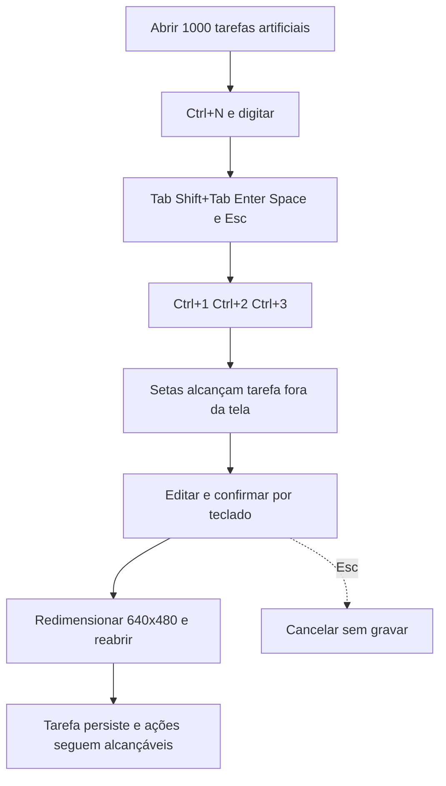

# J-navegar-lista: Administrar uma lista pelo teclado



```yaml
journey:
  id: J-navegar-lista
  name: Administrar uma lista pelo teclado
  value_statement: Tarefa distante é alcançável e alterações persistem com resposta medida até um segundo
  personas: [Pessoa usando teclado]
  entry_points:
    - url: cargo run --locked --release
      origin: direct
  actions:
    - step: 1
      verb: Abrir release com 1000 tarefas semeadas antes da abertura
      expected_observable: Resultado visível na janela e erro explícito se a ação falhar
    - step: 2
      verb: Percorrer foco, atalhos, setas e rolagem
      expected_observable: Resultado visível na janela e erro explícito se a ação falhar
    - step: 3
      verb: Editar tarefa fora da primeira página e confirmar
      expected_observable: Resultado visível na janela e erro explícito se a ação falhar
    - step: 4
      verb: Medir filtro e ação por início/fim observável
      expected_observable: Resultado visível na janela e erro explícito se a ação falhar
    - step: 5
      verb: Redimensionar e reabrir
      expected_observable: Resultado visível na janela e erro explícito se a ação falhar
  goal:
    observable: Tarefa distante é alcançável e alterações persistem com resposta medida até um segundo
    side_effects: [sqlite-commit]
  true_end_state: Tarefa distante é alcançável e alterações persistem com resposta medida até um segundo
  exit:
    natural: Fechar a janela após conferir o resultado
  abandonment:
    - at_step: 3
      how: Esc cancela edição ou diálogo e restaura foco sem alterar dados
      resume: Reabrir com último snapshot confirmado
  crosses: [gpui, sqlite, filesystem]
```

Cobertura: jornada completa, controles e feedback, falhas e cancelamento,
continuidade e interface em 900×640/640×480 conforme a missão. Conta, rede e
mobile não se aplicam.
