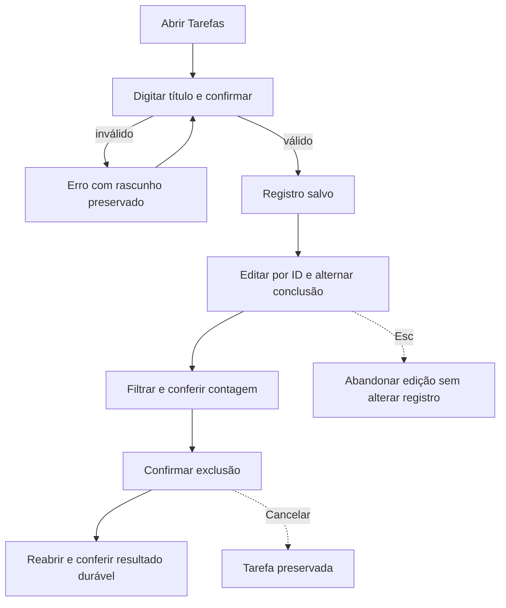

# J-organizar-tarefas: Organizar tarefas pessoais



```yaml
journey:
  id: J-organizar-tarefas
  name: Organizar tarefas pessoais
  value_statement: Tarefas corretas reaparecem na reabertura e a excluída permanece ausente
  personas: [Pessoa começando]
  entry_points:
    - url: cargo run --locked --release
      origin: direct
  actions:
    - step: 1
      verb: Abrir a janela vazia
      expected_observable: Resultado visível na janela e erro explícito se a ação falhar
    - step: 2
      verb: Criar título com acentos e emoji e uma duplicata
      expected_observable: Resultado visível na janela e erro explícito se a ação falhar
    - step: 3
      verb: Editar, concluir e reabrir uma tarefa
      expected_observable: Resultado visível na janela e erro explícito se a ação falhar
    - step: 4
      verb: Aplicar filtros e cancelar edição ou exclusão
      expected_observable: Resultado visível na janela e erro explícito se a ação falhar
    - step: 5
      verb: Confirmar exclusão e reabrir o app
      expected_observable: Resultado visível na janela e erro explícito se a ação falhar
  goal:
    observable: Tarefas corretas reaparecem na reabertura e a excluída permanece ausente
    side_effects: [sqlite-commit]
  true_end_state: Tarefas corretas reaparecem na reabertura e a excluída permanece ausente
  exit:
    natural: Fechar a janela após conferir o resultado
  abandonment:
    - at_step: 3
      how: Fechar durante um rascunho não confirmado; ao retornar só ações confirmadas permanecem
      resume: Reabrir com último snapshot confirmado
  crosses: [gpui, sqlite, filesystem]
```

Cobertura: jornada completa, controles e feedback, falhas e cancelamento,
continuidade e interface em 900×640/640×480 conforme a missão. Conta, rede e
mobile não se aplicam.
