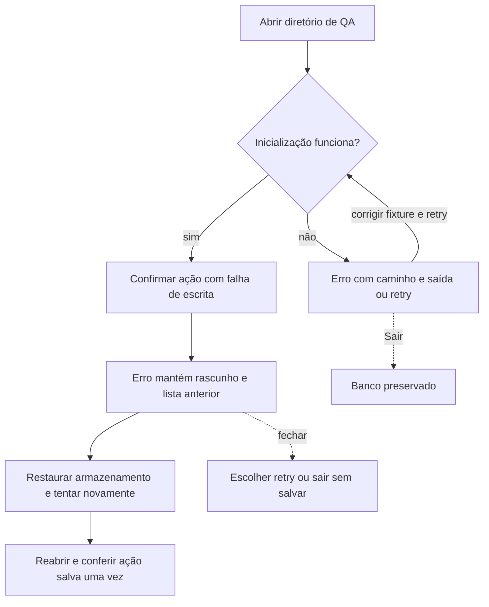

# J-recuperar-falhas: Recuperar uma operação sem perda



```yaml
journey:
  id: J-recuperar-falhas
  name: Recuperar uma operação sem perda
  value_statement: Erro é compreensível e os dados anteriores e o rascunho são preservados
  personas: [Pessoa recuperando dados]
  entry_points:
    - url: cargo run --locked --release
      origin: direct
  actions:
    - step: 1
      verb: Abrir fixtures de banco inválido, versão e path inválidos
      expected_observable: Resultado visível na janela e erro explícito se a ação falhar
    - step: 2
      verb: Abrir segunda instância do mesmo diretório
      expected_observable: Resultado visível na janela e erro explícito se a ação falhar
    - step: 3
      verb: Provocar falha de escrita em diretório descartável e confirmar tarefa
      expected_observable: Resultado visível na janela e erro explícito se a ação falhar
    - step: 4
      verb: Restaurar escrita e tentar novamente
      expected_observable: Resultado visível na janela e erro explícito se a ação falhar
    - step: 5
      verb: Reabrir e conferir durabilidade
      expected_observable: Resultado visível na janela e erro explícito se a ação falhar
  goal:
    observable: Erro é compreensível e os dados anteriores e o rascunho são preservados
    side_effects: [sqlite-commit]
  true_end_state: Erro é compreensível e os dados anteriores e o rascunho são preservados
  exit:
    natural: Fechar a janela após conferir o resultado
  abandonment:
    - at_step: 3
      how: Sair após erro preserva o banco; sair sem salvar descarta só a ação que falhou
      resume: Reabrir com último snapshot confirmado
  crosses: [gpui, sqlite, filesystem]
```

Cobertura: jornada completa, controles e feedback, falhas e cancelamento,
continuidade e interface em 900×640/640×480 conforme a missão. Conta, rede e
mobile não se aplicam.
