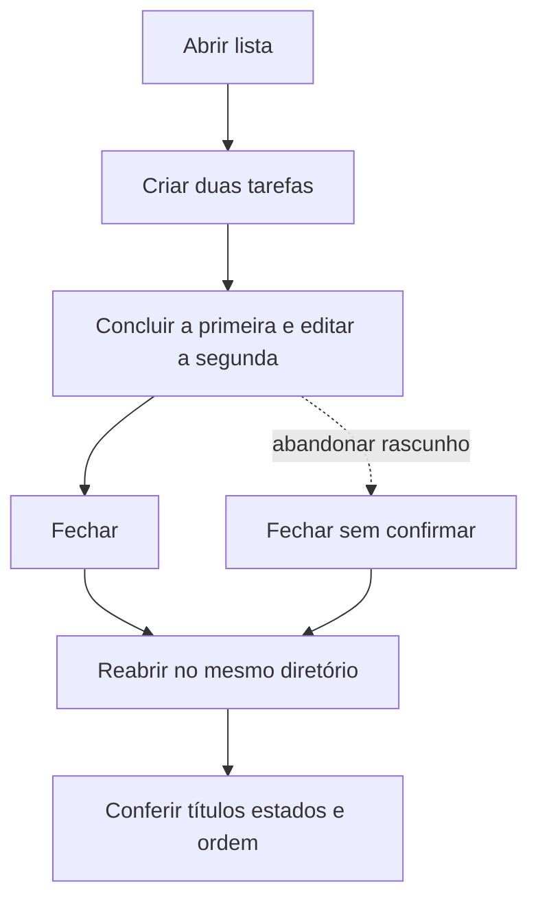

# J-retomar-lista: Retomar tarefas salvas



```yaml
journey:
  id: J-retomar-lista
  name: Retomar tarefas salvas
  value_statement: Conteúdo estado e ordem confirmados sobrevivem à reabertura
  personas: [Pessoa retomando]
  entry_points:
    - url: cargo run --locked --release
      origin: direct
  actions:
    - step: 1
      verb: Abrir um diretório isolado
      expected_observable: Resultado visível na janela e erro explícito se a ação falhar
    - step: 2
      verb: Criar e modificar tarefas
      expected_observable: Resultado visível na janela e erro explícito se a ação falhar
    - step: 3
      verb: Fechar inclusive com rascunho não confirmado
      expected_observable: Resultado visível na janela e erro explícito se a ação falhar
    - step: 4
      verb: Reabrir o mesmo diretório
      expected_observable: Resultado visível na janela e erro explícito se a ação falhar
  goal:
    observable: Conteúdo estado e ordem confirmados sobrevivem à reabertura
    side_effects: [sqlite-commit]
  true_end_state: Conteúdo estado e ordem confirmados sobrevivem à reabertura
  exit:
    natural: Fechar a janela após conferir o resultado
  abandonment:
    - at_step: 3
      how: Rascunho abandonado não é persistido; última ação confirmada reaparece
      resume: Reabrir com último snapshot confirmado
  crosses: [gpui, sqlite, filesystem]
```

Cobertura: jornada completa, controles e feedback, falhas e cancelamento,
continuidade e interface em 900×640/640×480 conforme a missão. Conta, rede e
mobile não se aplicam.
